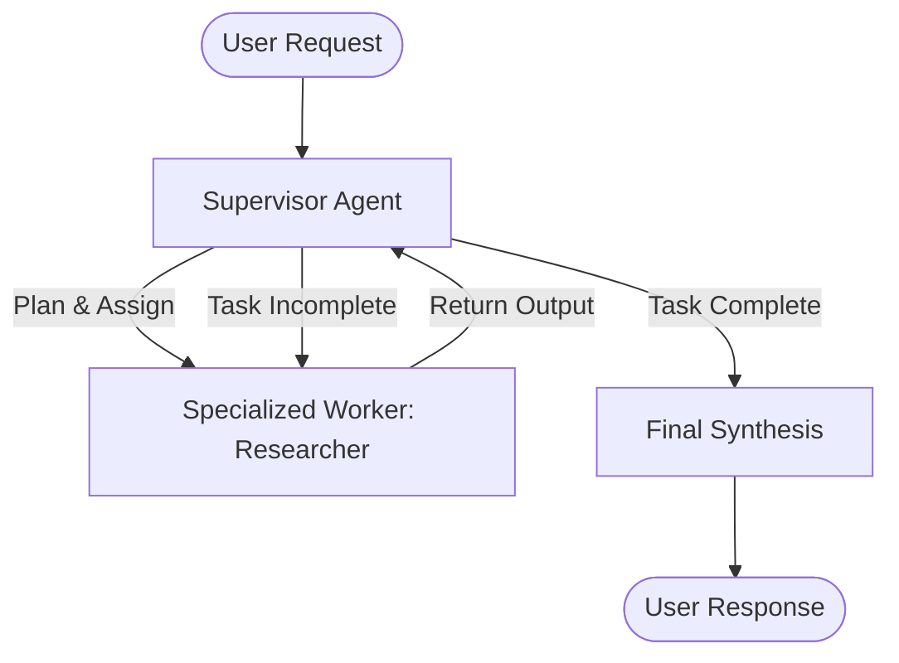

# 🕸️ LangGraph Agent Systems & Workflows

A modular, production-ready **LangGraph** repository showcasing stateful conversational agents, multi-agent supervisor systems, tool-augmented graphs, and end-to-end observability via **LangSmith**.

---

## 📌 Direct GitHub Notebook Links

Quickly access individual agent implementations:

| Module / Topic | Notebook / File | Core Concepts Covered | Key Components |
| :--- | :--- | :--- | :--- |
| **Standalone StateGraph Agent** | [`main.py`](./main.py) | Standalone command-line agent with state nodes, conditional routing & LangSmith | `StateGraph`, `START`, `END`, Google Gemini |
| **Graph Fundamentals** | [`basic_chat_1.ipynb`](./basic_chat/basic_chat_1.ipynb) | Typed state schema, computational nodes, directional edges, graph compilation | `TypedDict`, `StateGraph`, `ChatGroq` |
| **Observability & Tools** | [`debug_monitoring.ipynb`](./basic_chat/debug_monitoring.ipynb) | Dynamic model initialization, token metadata tracing, custom lifecycle callbacks, `ToolNode` | `init_chat_model`, `ToolNode`, `tools_condition` |
| **Multi-Agent Collaboration** | [`multiaiagent.ipynb`](./basic_chat/multiaiagent.ipynb) | Multi-agent coordination, specialized agent roles, and message routing | `StateGraph`, `HumanMessage`, `AIMessage` |
| **Supervisor Multi-Agent System** | [`super_multi_ai_agent.ipynb`](./basic_chat/super_multi_ai_agent.ipynb) | Supervisor-worker architecture: dynamic planning, task delegation, researcher node, state loop & memory | `MessagesState`, `MemorySaver`, Supervisor routing |

---

## 🗂️ Directory Structure

```text
langraphproject/
├── basic_chat/                           # Practical agent notebooks & patterns
│   ├── basic_chat_1.ipynb                # StateGraph fundamentals (State, Nodes, Edges)
│   ├── debug_monitoring.ipynb           # Dynamic init_chat_model, callbacks & ToolNode
│   ├── multiaiagent.ipynb                # Multi-agent role specialization
│   ├── super_multi_ai_agent.ipynb        # Supervisor pattern with planning & MemorySaver
│   └── README.md                         # Detailed basic_chat module documentation
│
├── main.py                               # Production StateGraph Agent entry point
├── pyproject.toml                        # Build system & package metadata
├── requirements.txt                      # Project dependencies
└── README.md                             # LangGraph module documentation
```

---

## 🚀 Key Architectural Patterns

### 1. Strongly Typed State (`TypedDict` & `MessagesState`)
* Enforces strict type contracts between agent graph nodes.
* Seamlessly reduces message histories using `add_messages` reducer to prevent manual state slicing.

### 2. Supervisor-Worker Pattern (`super_multi_ai_agent.ipynb`)

* **Supervisor**: Formulates the execution plan, delegates tasks to domain-specific worker agents, and monitors iteration thresholds.
* **Worker (Researcher)**: Performs targeted analysis and returns structured outputs to the shared graph state.
* **Memory Checkpointing**: State persistence across turns using `MemorySaver`.

### 3. Dynamic Tool Calling & Auto-Routing (`debug_monitoring.ipynb`)
* Integrates `@tool` decorated functions with LangGraph's prebuilt `ToolNode`.
* Uses `tools_condition` conditional edges to seamlessly toggle between tool execution and conversational responses.

### 4. Full Observability with LangSmith
* Automatic distributed tracing of every node invocation, token count, latency metric, and LLM call metadata.

---

## ⚙️ Setup & Execution

### 1. Navigate to Project
```bash
cd langraphproject
```

### 2. Create Virtual Environment
```bash
# Windows
python -m venv venv
venv\Scripts\activate

# Linux / macOS
python3 -m venv venv
source venv/bin/activate
```

### 3. Install Dependencies
```bash
pip install -r requirements.txt
```

### 4. Configure Environment Variables
Ensure your `.env` contains:
```env
GROQ_API_KEY=your_groq_api_key
GOOGLE_API_KEY=your_gemini_api_key
LANGCHAIN_TRACING_V2=true
LANGCHAIN_API_KEY=your_langsmith_api_key
LANGCHAIN_PROJECT=langgraph-agent-systems
```

### 5. Run the Standalone Agent
```bash
python main.py
```
